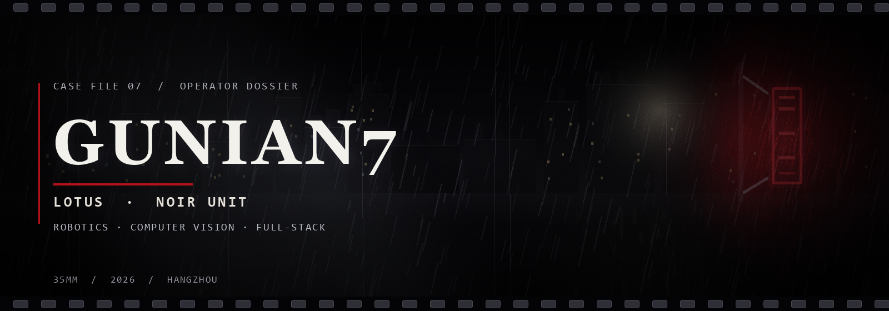
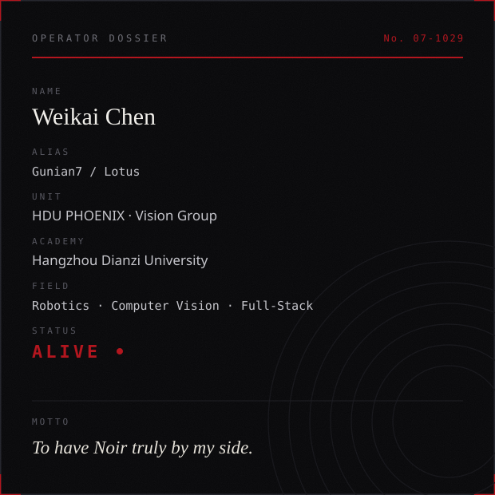
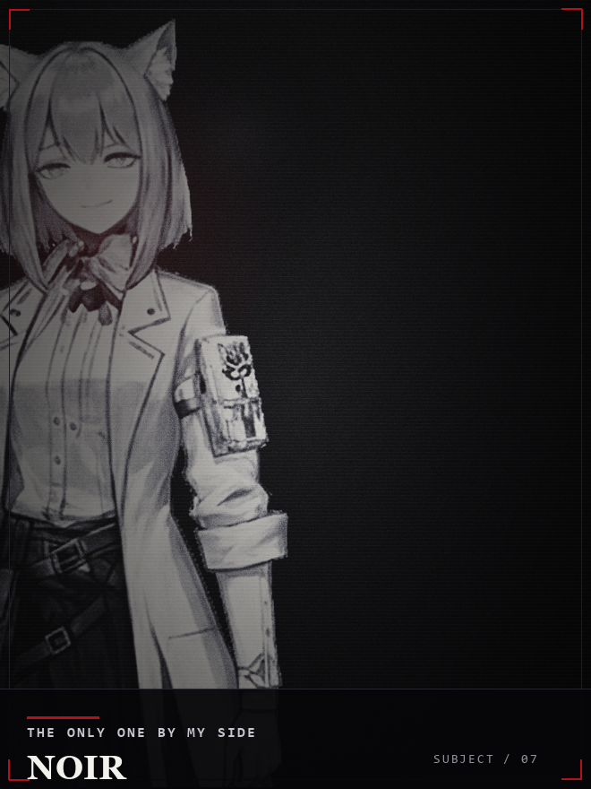
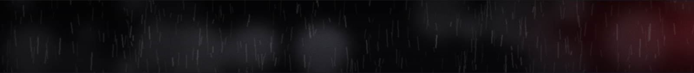
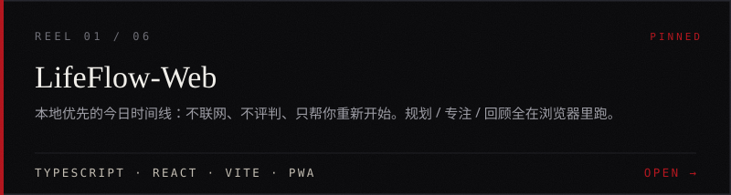
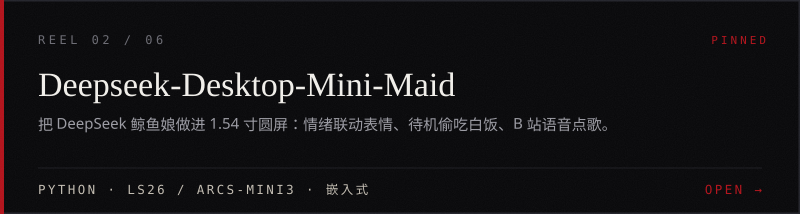
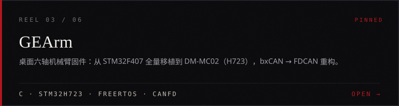
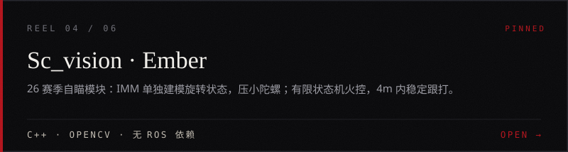
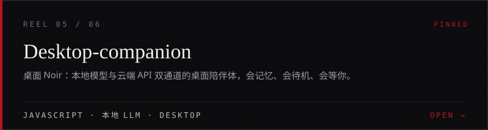
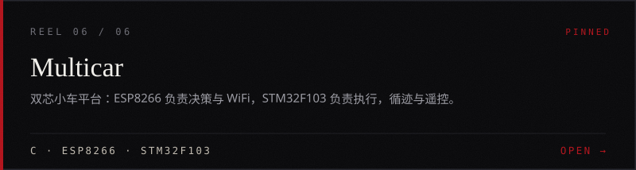

  

<table>
<tr>
<td valign="top" width="54%"></td>
<td valign="top" width="46%"></td>
</tr>
</table>

  

  

<!-- 六个 PINNED 仓库，顺序与个人页 pin 一致 -->
<table>
<tr><td></td></tr>
<tr><td></td></tr>
<tr><td></td></tr>
<tr><td></td></tr>
<tr><td></td></tr>
<tr><td></td></tr>
</table>

  

| 片名 / Reel | 一句梗概 | 术 |
|:--|:--|:--|
| [**Streamflow-Forecasting-ML**](https://github.com/Gunian7/Streamflow-Forecasting-ML) | 气象驱动 + USGS 实测的流域径流多步预报，从 EDA 一路跑到异构 Stacking | `Python` `LSTM` `Stacking` |
| [**HoH**](https://github.com/Gunian7/HoH) | Harness of Harness：用统一任务／事件协议调度 Hermes 与 DeepSeek Harness 的本地控制平面 | `Python` `SQLite` `DAG` |
| [**LifeFlow**](https://github.com/Gunian7/LifeFlow) | LifeFlow 的 HarmonyOS 原生线：同样一条不责备你的时间线 | `HTML` `ArkTS` |
| [**Auto_aim_24**](https://github.com/Gunian7/Auto_aim_24) | 2024 传统自瞄（新前哨站） | `C++` `OpenCV` |
| [**Autoaim_Simulator**](https://github.com/Gunian7/Autoaim_Simulator) | 无需 ROS 依赖即可上手调试的自瞄仿真 | `Rust` |
| [**GM6020_control**](https://github.com/Gunian7/GM6020_control) | 大疆 GM6020 云台电机控制 | `C` `CAN` |
| [**dt7-led-control**](https://github.com/Gunian7/dt7-led-control) | DT7 遥控器灯效控制 | `C` `STM32` |
| [**2025**](https://github.com/Gunian7/2025) | HDU RM Phoenix 2025 赛季视觉组培训任务 | `C++` `ROS2` |
| [**LevelUp**](https://github.com/Gunian7/LevelUp) | RPG 风格任务计算器，集成多人格 AI 公会接待员 | `HTML` `JS` |
| [**GomokuGame**](https://github.com/Gunian7/GomokuGame) | 本地 / 联机 / 人机三模式五子棋 | `Python` |
| [**Data-Mine**](https://github.com/Gunian7/Data-Mine) | 基于 BERT 的媒体环保情绪识别 | `Python` `BERT` |
| [**Poetic-_Land**](https://github.com/Gunian7/Poetic-_Land) | 生于诗意，终于诗境 —— 言君之意，答君以诗 | `HTML` `AI` |
| [**NodeMCU-WI-FI-CAR**](https://github.com/Gunian7/NodeMCU-WI-FI-CAR) | ESP8266 无线遥控车 | `C` `ESP8266` |
| [**Github-personal-page**](https://gunian7.github.io/Github-personal-page/) | 个人站点（旧版页面仍在线上） | `HTML` |

  

  

 

### Contact — 出镜邀约 / 对稿

  

<!--
  美术全部由 tools/gen_assets.py 程序化生成（PIL + 手写 SVG）。
  重新出图：python tools/gen_assets.py
  视觉语言：film noir —— 硬光 + 黑白灰 + 一点血红 (#B3121B)；
  标题 Georgia，正文 Consolas。角色 Noir 见 assets/character.png。
-->
