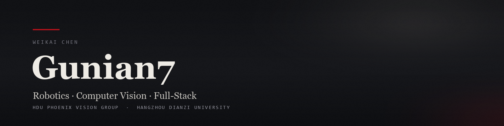

  

杭电 PHOENIX 战队视觉组，做机器人视觉、嵌入式和一点全栈。
习惯是先把问题拆小，再慢慢把它做对。

本科在读 · Hangzhou Dianzi University · HDU PHOENIX Vision Group (2026~)

## 在做的事

| 项目 | 做什么 | 技术栈 |
|:--|:--|:--|
| **[LifeFlow-Web](https://github.com/Gunian7/LifeFlow-Web)** | 本地优先的今日时间线，不联网也不评判 | `TypeScript` `React` `PWA` |
| **[GEArm](https://github.com/Gunian7/GEArm)** | 六轴机械臂固件，F407 → DM-MC02 移植 | `C` `STM32H7` `FreeRTOS` |
| **[Sc_vision](https://github.com/Gunian7/Sc_vision)** | 26 赛季自瞄模块，IMM 建模旋转 | `C++` `OpenCV` |
| **[Deepseek-Desktop-Mini-Maid](https://github.com/Gunian7/Deepseek-Desktop-Mini-Maid)** | 圆屏桌面陪伴体：情绪表情 / 点歌 | `Python` `LS26` |
| **[Desktop-companion](https://github.com/Gunian7/Desktop-companion)** | 桌面 Noir，本地模型 + 云端 API | `JavaScript` |
| **[Multicar](https://github.com/Gunian7/Multicar)** | 双芯小车：ESP8266 决策 + STM32 执行 | `C` `ESP8266` |

  

## 其他项目

展开 14 个仓库

 

| 项目 | 做什么 | 技术栈 |
|:--|:--|:--|
| **[Streamflow-Forecasting-ML](https://github.com/Gunian7/Streamflow-Forecasting-ML)** | 流域径流多步预报，EDA → 异构 Stacking | `Python` `LSTM` |
| **[HoH](https://github.com/Gunian7/HoH)** | 调度 Hermes 与 DeepSeek Harness 的本地控制平面 | `Python` `SQLite` |
| **[Autoaim_Simulator](https://github.com/Gunian7/Autoaim_Simulator)** | 无需 ROS 依赖的自瞄仿真 | `Rust` |
| **[Auto_aim_24](https://github.com/Gunian7/Auto_aim_24)** | 2024 传统自瞄（新前哨站） | `C++` `OpenCV` |
| **[LifeFlow](https://github.com/Gunian7/LifeFlow)** | LifeFlow 的 HarmonyOS 原生线 | `ArkTS` |
| **[2025](https://github.com/Gunian7/2025)** | 2025 赛季视觉组培训任务 | `C++` `ROS2` |
| **[S27_tutorial](https://github.com/Gunian7/S27_tutorial)** | 27 赛季视觉组培训 | `C++` |
| **[GM6020_control](https://github.com/Gunian7/GM6020_control)** | 大疆 GM6020 云台电机控制 | `C` `CAN` |
| **[dt7-led-control](https://github.com/Gunian7/dt7-led-control)** | DT7 遥控器灯效控制 | `C` `STM32` |
| **[LevelUp](https://github.com/Gunian7/LevelUp)** | RPG 风格任务计算器 + AI 公会接待员 | `HTML` `JS` |
| **[GomokuGame](https://github.com/Gunian7/GomokuGame)** | 本地 / 联机 / 人机三模式五子棋 | `Python` |
| **[Data-Mine](https://github.com/Gunian7/Data-Mine)** | 基于 BERT 的环保情绪识别 | `Python` `BERT` |
| **[Poetic-_Land](https://github.com/Gunian7/Poetic-_Land)** | 言君之意，答君以诗 | `HTML` |
| **[NodeMCU-WI-FI-CAR](https://github.com/Gunian7/NodeMCU-WI-FI-CAR)** | ESP8266 无线遥控车 | `C` `ESP8266` |

## 技术栈

`C` `C++` `Python` `TypeScript` `JavaScript` `Rust`
`OpenCV` `ROS2` · `STM32 / FreeRTOS` `CAN / FDCAN` `ESP8266` · `Linux` `Git`

  

## 联系

邮箱 [1328037882@qq.com](mailto:1328037882@qq.com) · 主页 [gunian7.github.io](https://gunian7.github.io/Github-personal-page/)

<!--
  美术：assets/banner.png 与 assets/rule.svg，均由 tools/gen_assets.py 生成（python tools/gen_assets.py）。
  视觉：深炭灰 + 米白 + 一点血红 #B3121B；标题 Georgia，标签 Consolas。
  正文全部为 markdown 文本：可读、可选中、可搜索，浅色/深色主题都正常。
-->
